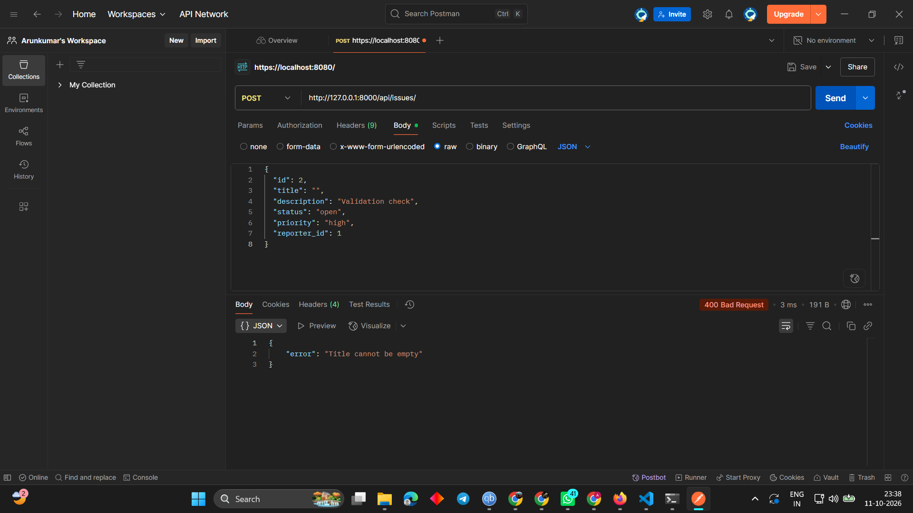

# DevTrack 

This is a minimal Django backend API for tracking engineering issues.

Run:

1. Create a virtualenv and install dependencies:

```bash
python -m venv .venv
.venv\Scripts\activate    # Windows
pip install -r requirements.txt
```

2. Start the dev server:

```bash
python manage.py runserver
```

Endpoints:
- `POST /api/reporters/` — create reporter (JSON body: `id`, `name`, `email`, `team`)
- `GET /api/reporters/` — list reporters
- `GET /api/reporters/?id=1` — get reporter by id
- `POST /api/issues/` — create issue (JSON body: `id`,`title`,`description`,`status`,`priority`,`reporter_id`)
- `GET /api/issues/` — list issues
- `GET /api/issues/?id=1` — get issue by id
- `GET /api/issues/?status=open` — filter by status

Design decision:
- I stored data in simple JSON files (`reporters.json`, `issues.json`) to match the exercise requirements and keep the project database-less for easy testing via Postman.

Postman collection:
- A ready-to-import Postman collection is included at `postman_collection.json`.

Example responses and screenshots:

Success (201 Created):


Validation failure (400 Bad Request):



How to capture screenshots:
1. Import `postman_collection.json` into Postman.
2. Start the Django dev server: 

```powershell
python devtrack/manage.py runserver
```

3. Run the `Create Reporter` request, then `Create Critical Issue` request.
4. For the successful response, take a screenshot and save to `postman_screenshots/create_issue_success.png`.
5. For a failure screenshot, send a request with an empty `title` to `/api/issues/` to trigger a 400 and save as `postman_screenshots/create_issue_failure.png`.

Testing notes:
- Example success response for the critical issue POST is:

```
{
	"id": 1,
	"title": "Login button not working on mobile",
	"description": "Users on iOS 17 cannot tap the login button",
	"status": "open",
	"priority": "critical",
	"reporter_id": 1,
	"created_at": "...",
	"message": "[URGENT] Login button not working on mobile — needs immediate attention"
}
```

And an example validation error response:

```
{ "error": "Title cannot be empty" }
```

Quick curl examples
1) Create a reporter:

```bash
curl -X POST http://localhost:8000/api/reporters/ \
	-H "Content-Type: application/json" \
	-d '{"id":1,"name":"Alice","email":"alice@example.com","team":"backend"}'
```

2) Create an issue:

```bash
curl -X POST http://localhost:8000/api/issues/ \
	-H "Content-Type: application/json" \
	-d '{"id":1,"title":"Login bug","description":"...","status":"open","priority":"critical","reporter_id":1}'
```

Create Pull Request
- I pushed these changes to a branch `ci-readme-improvements`. Open this URL in your browser to create a PR: https://github.com/arunkumaraj1-design/Devtrack/compare/main...ci-readme-improvements?expand=1
